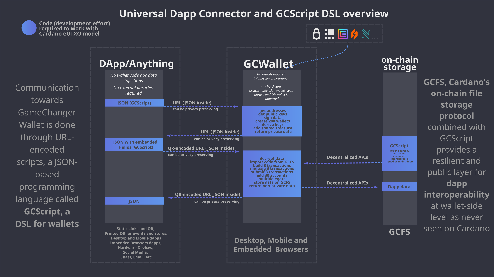

# [GCScript DSL](README.md) / Overview

## Introduction

**GCScript DSL is an intent-based, JSON-based domain-specific language for describing and executing wallet workflows.** Applications express what they want to accomplish, and the wallet resolves those instructions using its capabilities, the user's wallet context, and the permissions granted by the user.

GCScript was originally created and implemented in GameChanger Wallet. Its foundations date to the wallet's API design in 2021, which evolved into GCScript in 2022. The language is not designed exclusively for GameChanger Wallet or the Cardano blockchain. This documentation covers language and syntax while using current GameChanger Wallet implementation for Cardano; available functions and blockchain capabilities depend on the implementation.

The original design principles applied for Web3:

- Let the wallet build transactions and manage the user's UTxOs, including coin selection and change.
- Allow applications to work without collecting user addresses, balances, or UTxOs when those details can remain inside the wallet.
- Make requested operations inspectable so users can review complete dapps/protocol behavior before authorizing it.
- Keep scripts usable independently of an application's frontend, including for recovery when that frontend is unavailable.
- Connect applications, hardware, and other agents without requiring JavaScript injection into websites.

## The GCScript DSL

Applications and other calling agents send GCScript as JSON to a compatible wallet (runner). Its interpreter validates the script, executes the requested operations under the wallet's permission model, and returns explicitly exported results as JSON.

An **intent** describes a requested action or workflow. It can read wallet data, build a transaction, request signatures, submit transactions, or combine several operations. An intent is distinct from an on-chain transaction: several intents can contribute to one transaction, while one workflow can produce multiple transactions.

DSL provides native Cardano and wallet-related functions ruled by permissions, with [Inline Scripting Language (ISL)](ISL.md) for transforming data, validating inputs, and passing results between steps in a permission-less way. Applications can leave transaction construction, balancing, and wallet-specific details to the wallet while users retain control over authorization and signing.

The mechanism used to package and exchange scripts and their JSON results is called a **transport**. The language is transport-agnostic; GameChanger Wallet's [Universal Dapp Connector](../universal-dapp-connector/overview.md) delivers these workflows through URLs and QR codes, among other supported transports.

<div style="text-align:center">
    
</div>

## Benefits

- **Intent-based execution:** describe wallet actions and compose them into workflows that the wallet resolves in the user's context.
- **JSON for universal interoperability:** generate, inspect, store, and exchange scripts from virtually any programming language or platform with JSON support. Frontends, backends, and hardware can integrate without a language-specific SDK. Users can also run scripts directly without an application frontend.
- **Transport-agnostic delivery:** exchange scripts and results without a persistent connection, including through bidirectional URL redirects and QR codes. Reusable links and printed QR codes can resolve wallet-specific details at execution time.
- **Scoped capabilities:** scripts invoke functions exposed by the interpreter rather than arbitrary host-platform code. The current implementation provides Cardano and wallet operations; other implementations can define their own domain capabilities.
- **Determinism by design:** GCScript and ISL are deliberately **not Turing complete**. Their constrained execution model supports deterministic evaluation, easier inspection, and security by limiting expressiveness. Results involving wallet state, network data, or user decisions still depend on those external inputs.
- **Permissions and user control:** requested capabilities and data sharing are governed by wallet permissions and user approval. See the [permission reference](https://wallet.gamechanger.finance/doc/api/v2/permissions.html) for the current implementation.
- **Inspectable by default:** deployed scripts can be inspected, debugged, and reused. Encrypted payloads require decryption before inspection; reuse of third-party code is allowed and suggested by default to foster open ecosystems.
- **Privacy-preserving workflows:** resolve addresses, balances, and UTxOs inside the wallet and return only the data an application needs. Privacy depends on the script's requested operations and exports.
- **Schema-defined and extensible:** JSON schemas define function arguments and result contracts, supporting validation, generated documentation, and the addition of native functions and features. See the [current API reference](https://wallet.gamechanger.finance/doc/api/v2/).
- **Codegen-friendly:** Because you can express entire intents/actions/workflows with this JSON-based universally-supported language, you can generate source code with any programming language and on any platform to integrate and execute the JSON payloads on wallet/runners. 
- **Modular and composable:** define reusable blocks, import third-party scripts, and connect results to later operations. Shared scripts can expose reusable protocol interfaces and include explicit service-fee outputs where appropriate.


## What is it for?

Use GCScript to build payment links and checkout flows, token and NFT tools, dapps, backend, and static screen/paper integrations, DeFi and smart-contract interactions, staking operations, wallet onboarding, and workflows involving multiple transactions and wallet generation for events and classrooms. It connects websites, mobile applications, hardware, and AI agents to wallet capabilities while keeping authorization with the user.

For working Cardano integrations, explore the [example catalog](../../examples/README.md). The [Quick Start](quick-start.md) explains how to run your first script.

## Basic Properties

- Function calls are JSON objects with a `type` property naming the function: `"type":"<FUNCTION_NAME>"`.
- Calls of `"type":"script"` define code blocks that can contain nested function calls and code blocks.
- Function arguments are JSON object properties, and function results are JSON values.
- By default, code blocks produce results with the same structure as their code: an **isomorphic** result structure.
- Each code block stores its results in a local `cache`, following that structure.
- Arrays and key-value maps are both accepted as lists of calls and normalized internally as key-value maps.
- Each code block can export its results under a custom name using `"exportAs":"<EXPORT_NAME>"`.
- Variable names can contain `a..z`, `A..Z`, `0..9`, and `_`, without whitespace or other special characters.
- ISL embeds expressions with JavaScript-like syntax in supported function arguments to validate inputs, debug through the connector's console, pass results between functions, and perform encoding, cryptographic, arithmetic, string, and other supported operations.
- The GameChanger Wallet interpreter processes GCScript in three stages: preprocessing, runtime execution, and postprocessing.
- Some functions are available only during specific stages. For example, external script imports run during preprocessing.

## Hello World

*A simple "Hello World" example in GCScript:*
```json
{
    "type": "script",
    "title": "Example",
    "description": "This dapp connection once executed on a wallet will return 'Hello World!' ",
    "exportAs": "myResults",
    "run": {
        "myVariable":{
            "type":"data",
            "value":"Hello World!"
        }
    }
}
```
<a href="https://wallet.gamechanger.finance/api/2/run/1-H4sIAAAAAAAAA02OwQrCMAyGXyXmssuewJsHwbOInmMbsJC1pU3dxti7myKCt_xfwpd_Q10z4xGrKyErjqhBpYPzQlO2aUTP32VI0fjtFSp4yhlcipFdx5CiY-CFXVP2loBgJhFWmIMIFNZWIgwXFknwSEX8YQBT85JT0VM177ReuTbRarg0-7QZulMJ9Ox9tl9RT0p28iZpPf4rcd_3D8h2n7_RAAAA?networkTag=mainnet" target="_blank" onclick="window.open(this.href, 'dapp connection', 'width=400,height=600'); return false;" style="text-decoration:none; outline:none;">
 
</a>
<a href="https://wallet.gamechanger.finance/api/2/run/1-H4sIAAAAAAAAA02OwQrCMAyGXyXmssuewJsHwbOInmMbsJC1pU3dxti7myKCt_xfwpd_Q10z4xGrKyErjqhBpYPzQlO2aUTP32VI0fjtFSp4yhlcipFdx5CiY-CFXVP2loBgJhFWmIMIFNZWIgwXFknwSEX8YQBT85JT0VM177ReuTbRarg0-7QZulMJ9Ox9tl9RT0p28iZpPf4rcd_3D8h2n7_RAAAA?networkTag=preprod" target="_blank" onclick="window.open(this.href, 'dapp connection', 'width=400,height=600'); return false;" style="text-decoration:none; outline:none;">
 
</a>

🔍 *See also:*
[script](https://wallet.gamechanger.finance/doc/api/v2/api.html),
[data](https://wallet.gamechanger.finance/doc/api/v2/data.html)

*and the isomorphic results:*
```json
{
  "exports": {
    "myResults": {
      "myVariable": "Hello World!"
    }
  }
}
```
<details>
  <summary>Do you know Javascript?</summary>

  Here is a free interpretation on how the code would look like in Javascript:

```js
let exports={}

function data(value){
    return value;
}
function script(title,description,exportAs){
    let cache={};
    cache["myVariable"]=data("Hello World!");
    exports[exportAs]=cache;
    return cache;
}

script(
    "Example",
    "This dapp connection once executed on a wallet will return 'Hello World!'",
    "myResults");

```


</details>


Previous: [GCScript DSL](README.md) | Next: [Quick Start](quick-start.md)
